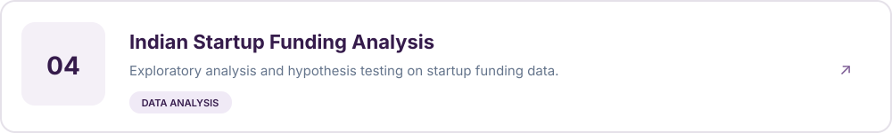
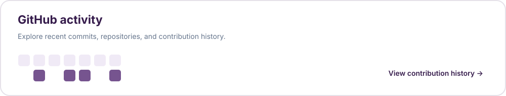

# Delphin Kaduli

  

  
  
  

## Featured work

## GitHub activity

  

  

## Tools I work with

  **Python** · **SQL** · **scikit-learn** · **XGBoost** · **CatBoost** · **Airflow** · **dbt** · **AWS** · **Docker** · **Tableau** · **Power BI** · **FastAPI**

---

  <a href="https://datawithdelphin.com/en">Portfolio</a> ·
  <a href="https://www.linkedin.com/in/delphin-kaduli">LinkedIn</a> ·
  <a href="https://github.com/DelphinKdl">GitHub</a>

